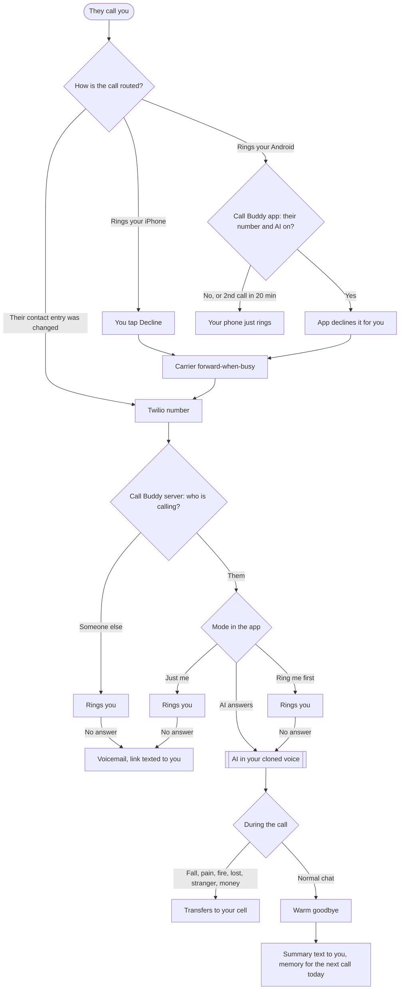

# Call Buddy

An AI that speaks in **your cloned voice** and answers calls from one person: a family member with Alzheimer's who calls several times a day and doesn't remember the earlier calls. It is patient every time and never says "you already called." It transfers emergencies to your real phone and texts you a short summary after each call.

**You run everything from your phone (iPhone or Android).** The app opens from your Home Screen. You use it to record your voice, clone it, tell the AI about them, switch it on or off, and read today's calls. The part that actually answers the phone runs in the cloud. iOS doesn't let any app answer calls or run a server in the background, so the cloud part is required.

## Setup, all on your iPhone (about 30 minutes)

### 1. Make three accounts (in Safari)
- **ElevenLabs** (elevenlabs.io), Starter plan or higher, which allows voice cloning. Go to Profile → API Keys and create a key.
- **Twilio** (twilio.com). Buy one phone number with Voice and SMS, about $1.15 a month. From the Console home page, note the **Account SID** and **Auth Token**.
- **Render** (render.com). Sign in with GitHub. This hosts Call Buddy for about $7 a month. Free hosting plans go to sleep and would miss calls.

### 2. Put Call Buddy online
In Safari, open **https://render.com/deploy?repo=https://github.com/soursnake71/the-system**. If this branch isn't merged yet, go to Render → New → Blueprint, pick the repo, and choose this branch. Render reads `render.yaml` and asks for:

| Setting | What to enter |
|---|---|
| `ADMIN_KEY` | A password you make up. You'll type it into the app. |
| `ELEVENLABS_API_KEY` | From ElevenLabs |
| `TWILIO_ACCOUNT_SID`, `TWILIO_AUTH_TOKEN` | From Twilio |
| `TWILIO_NUMBER` | The Twilio number, like `+15550000000` |
| `MY_NAME`, `CALLER_CALLS_ME` | Your name, and what they call you ("Chris", "son", "honey") |
| `MY_CELL` | Your iPhone number, like `+15551112222` |
| `CALLER_NAME`, `CALLER_NUMBERS` | Their name, and their number(s), comma-separated |
| `TZ` | Your time zone, like `America/New_York` |

Tap **Apply**. When it's live, Render shows a link like `https://callbuddy-xxxx.onrender.com`.

### 3. Install the app
Open that link in **Safari**, tap **Share → Add to Home Screen**, and open **Call Buddy** from your Home Screen. Sign in with your `ADMIN_KEY`.

### 4. Follow the Setup tab
1. **Voice tab:** tap the red button and read the script, then keep chatting naturally. 1–3 minutes total is plenty; several short takes are fine. Allow the microphone when asked.
2. Tap **Clone my voice**, then **Play** to hear your clone.
3. **About tab:** fill in what they love to talk about, safe facts about you, their nurse's name, and how you answer the phone. Then tap **Save**.
4. **Setup tab:** tap **Build / update the AI**.
5. Copy the first link into **Twilio**: Phone Numbers → your number → Voice → "A call comes in" → Webhook (HTTP POST). Also set **"Primary handler fails"** to a TwiML Bin containing `<Response><Dial>YOUR CELL</Dial></Response>`, so their call reaches you even if the server is down.
6. Copy the second link into **ElevenLabs**: Agents → Settings → Post-call webhook. You can also put the webhook's secret into Render as `ELEVENLABS_WEBHOOK_SECRET`.
7. In the ElevenLabs site, open the agent and **talk to it** to test it before going live. Under **Tools**, check that "Transfer to number" points to your cell. If the app warned that it couldn't add this tool, add it there by hand.

### 5. Get their calls to the Twilio number
The iPhone can't hand a live call's audio to an app, so their call has to land on the Twilio number. Pick one:

- **A. Change their contact entry (recommended).** Ask their caregiver or facility to change the number saved under your name, or on their speed dial, to the **Twilio number**. They press the same button as always. If anyone else calls the Twilio number, it is passed straight through to your iPhone.
- **B. Forward when busy (no one else needs to change anything).** On your iPhone, open the Phone app and dial the code for your carrier, then press call:
  - AT&T / T-Mobile / most GSM carriers: `**67*1TWILIONUMBER#` (example `**67*15550000000#`). To undo it: `##67#`.
  - Verizon: `*90` + the Twilio number (busy forwarding). To undo it: `*900`. Codes vary by plan, so check with your carrier.

  When their call rings, tap **Decline** (or press the side button twice). The carrier forwards the call to Twilio, and Call Buddy recognizes their number and answers in your voice. Anyone else you decline is passed back to ring your iPhone. Don't use Settings → Phone → Call Forwarding: that forwards **every** call.

## Android app
Android can do one thing an iPhone can't: **Call Buddy recognizes their number and declines it for you**, so it forwards to the AI without you touching the phone.

1. Download **call-buddy.apk** from the `callbuddy-latest` release on GitHub. The `Call Buddy APK` workflow builds it. Open the file to install it; Android asks you to allow installs from your browser. Needs Android 10 or newer.
2. Open Call Buddy, enter your server address (the Render link), and sign in.
3. On the **Setup** tab, under "This Android phone":
   - **Call screening → Allow**, and pick Call Buddy.
   - **Contacts access → Allow**. Android only screens saved contacts when this is on.
   - Tap your carrier's button. The dialer opens with the forward-when-busy code typed in; tap Call once.
   - Turn on **Send their calls to the AI**.

It only auto-declines while the mode is **AI answers**. A second call from them within 20 minutes rings through to you. That is either the AI's emergency transfer or them calling right back, and you should hear both.

## Day to day
Open Call Buddy from your Home Screen:
- **AI answers**, **Ring me first** (your phone rings, and the AI answers if you don't pick up), or **Just me** (AI off).
- **Today's calls** shows a summary of each call, flagged ⚠️ MONEY, MEDS or EMERGENCY when one of those came up.
- After each call you also get a text with the summary. Set `SMS_SUMMARIES=false` in Render to turn that off. Flagged calls are always texted.
- Edit the **About** tab any time. Saving updates the AI.

## Safety built in
- **Emergencies** (a fall, pain, fire, being lost, a stranger, someone asking for money) → the AI transfers the call to your cell immediately. If the transfer fails, it tells them to dial 911.
- It never agrees to money, purchases or account details, never gives medication advice, and never promises a visit. It only uses facts you wrote on the About tab.
- If ElevenLabs is down or anything errors, the call **rings your phone** instead of going silent.
- Twilio and ElevenLabs webhook signatures are verified, and the app needs your password.
- If they sincerely and repeatedly ask whether it's a machine, the AI won't flatly deny it. It says it's your phone helper and that you'll call back. This is set in `prompt.md`.

## Please also
- **Tell their caregiver or facility** that this is set up, so a person can follow up on anything that gets flagged.
- **Recording and consent laws** differ by state and country, and ElevenLabs stores transcripts. You can turn on zero-retention in ElevenLabs.
- **Clone only your own voice.** ElevenLabs requires consent from the voice's owner.
- Still call them yourself sometimes. The summaries give you things to talk about.

## For developers
`npm test` runs offline tests with fake Twilio and ElevenLabs. `npm start` runs the server locally, and `npm run setup` does the voice clone and agent setup from the command line. Settings come from environment variables or `.env` (see `.env.example`). The voice and agent ids and the profile are saved to `CALLBUDDY_DATA`.
