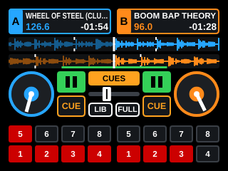
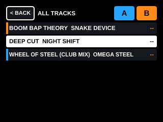

# Omega plugins

The Omega System's instruments and effects as separate VST3 plugins (AU too on Mac), for any desktop DAW.
The sound engines are line-for-line C++ ports of the web app's own code (`index.html`); `tools/compare.mjs` runs the
app's code in Node and the C++ in `tools/dsp_test.cpp` on the same signal, and their levels match.

| Plugin | Type |
|---|---|
| Omega Prophet-5 | instrument |
| Omega Vox (Prophet-5 + vocoder + talking machine) | instrument |
| Omega Speech (talking machine) | instrument |
| Omega Vocoder 350 | effect (MIDI or sidechain carrier) |
| Omega Lexicon 224, PrimeTime, Effectron, DP4, Microverb, ADA Flanger, 1176, Phil Collins Sim, H910, MXR 113 | effects |
| Omega Bus Compressor, Resonance Tamer, Gate Stepper | effects |
| Omega Twelve (12-bit sampler emulator, also a standalone app) | effect with MIDI in: live input through the sampler, samples played from MIDI |
| Omega Twelve Instrument | instrument (same, for hosts that only send MIDI to instruments) |
| Omega Wheel of Steel (two turntables + DJ mixer, also a standalone app) | instrument, played from an MPC or any MIDI controller |

Download: the `vst3-latest` release has a zip for Windows, Mac and Linux, built by `.github/workflows/vst3.yml`.

Build yourself: `cmake -S plugins -B build -DCMAKE_BUILD_TYPE=Release && cmake --build build --config Release`.
Parameter tables come from the app: `node plugins/tools/gen.mjs` regenerates `gen/tables.inc`.

Omega Twelve lives in `twelve/` and doesn't use the shared Spec/Editor: it has its own sample editor, presets (generated from the
app by `node twelve/tools/gen.mjs`), master chain and file export. Tests: `twelve_test` + `node twelve/tools/compare.mjs`
(C++ against the app's engine), `twelve_proc_test` (sampler, MIDI, exports, analysis, state), and `tools/hosttest` (`twelve_host_test`
loads the built .vst3 like a DAW).

## Omega Wheel of Steel (`wheel/`)
Two turntables and a DJ mixer in the style of Serato DJ on two SL-1200s and a scratch mixer, built to be played from
an Akai MPC. Written from scratch: `Engine.cpp` (decks, mixer, beat FX, no JUCE), `Library.cpp` (crates, Serato tags,
decoding, BPM / key / waveforms), `WheelPlugin.cpp` (parameters, MIDI, MPC pads, state), `WheelEditor.cpp` (the screen).
Tests: `wheel_engine_test [wav dir]` and `wheel_lib_test`.

**Library.** Choose your SD card (or any drive or folder). Serato crates from `_Serato_/Subcrates` (nested crates
too) are listed first, then `.m3u` playlists, then every folder with music in it as a crate. Crates made on a Mac or
PC find their tracks on the card even when the drive letter or volume name differs. Serato's hot cues (with colours
and names), saved loops, beatgrid, BPM and key are read from MP3, WAV, AIFF, FLAC, Ogg and M4A; anything missing is
detected (BPM and first downbeat, key in Camelot).

**Decks.** Motor start and brake (adjustable), 33 / 45, pitch ±8 / 16 / 50 %, key lock, nudge, Serato/CDJ cue,
8 hot cues, auto loops 1/32 to 32 beats, manual loop in / out, reloop, ½ and ×2, loop rolls, slip, censor, quantize,
sync (to the other deck, or to the MPC's tempo with Host Tempo Sync). Drag a platter or a waveform to scratch.
**Mixer.** Trim, HI / MID / LOW with full kills, a filter knob (low-pass left, high-pass right), channel faders,
crossfader with curve (smooth blend to a sharp scratch cut), hamster, crossfader assign, cue / headphones on an
optional second output. **Beat FX** per deck: echo, ping-pong, reverb, flanger, phaser, bitcrush, gate.

**The MPC screen.** The plugin opens as a 320 x 240 screen made for the MPC: everything sits inside a 12 px margin
(so the MPC's own menus can cover the edges) in bold blocks and heavy text. Deck headers (title, BPM, time left), two
waveform strips with bar ticks, cues and loops, the two platters (drag to scratch) with PLAY and CUE, the pad mode
(tap to change), the crossfader, 8 pads per deck, LIB for a full-screen crate browser (crates, then tracks, then A or
B to load) and FULL for the whole Serato-style layout (MPC VIEW there comes back). It scales up if given more room.

 

### Playing it from an MPC
An MPC running standalone can't load third-party plugins; run the MPC software on a computer (controller mode) and
load Omega Wheel of Steel on a plugin track (or use any DAW, or the standalone app).

**Q-Links / faders.** Every control is a plugin parameter, so assign Q-Links straight to them: Crossfader, Deck A /
B Channel Fader, Pitch, Filter, HI / MID / LOW, FX depth... **Deck A / B Platter (Scratch)** on a Q-Link or the touch
strip scratches: one full sweep of the knob is one turn of the record (1.8 s), and the hand lifts 60 ms after you stop.
For an endless jog wheel, use MIDI learn with a relative (endless) encoder.
**Fader = crossfader, out of the box.** The touch strip (pitch bend) or a fader sending CC 1, on any MIDI channel,
moves the crossfader with no setup. The plugin lists its parameters crossfader first, then Deck A / B Channel Fader,
Deck A / B Platter, pitch, filter and EQ, so Q-Links assigned in order land on the DJ controls. MIDI learn another
control for the crossfader and it replaces CC 1; CLEAR ALL goes back to the defaults.

**Pads.** Left two columns = deck A, right two = deck B (pad 1 is bottom left). Pad base note 37 matches MPC pad 1
(set it to 36 for a chromatic C1 layout). Pads of bank B 1-4 (base + 16..19) switch the pad mode.

| Slot | Deck A pad | Deck B pad | Hot cues | Auto loop | Roll (hold) | Transport |
|---|---|---|---|---|---|---|
| 1 | 1 | 3 | CUE 1 | 1/4 | 1/32 | PLAY |
| 2 | 2 | 4 | CUE 2 | 1/2 | 1/16 | CUE (hold) |
| 3 | 5 | 7 | CUE 3 | 1 | 1/8 | SYNC |
| 4 | 6 | 8 | CUE 4 | 2 | 1/4 | CENSOR (hold) |
| 5 | 9 | 11 | CUE 5 | 4 | 1/2 | NUDGE − |
| 6 | 10 | 12 | CUE 6 | 8 | 1 | NUDGE + |
| 7 | 13 | 15 | CUE 7 | 16 | 2 | LOOP IN |
| 8 | 14 | 16 | CUE 8 | 32 | 4 | LOOP OUT / EXIT |

Notes on MIDI channel 2 play deck A's slots (note % 8), channel 3 deck B's. **MIDI learn** (the MIDI / MPC panel):
press LEARN, click any control, platter or pad, then move a knob or hit a pad. Pad hits and Q-Link moves recorded in
an MPC sequence play back, so a routine can be recorded and edited.

### On the MPC Sample (an SD-card OS)
The MPC Sample runs Linux on a 64-bit ARM chip (RK3566), with a 320 x 240 screen and no window system. The
`Omega-Plugins-Linux-ARM64.zip` build is for it: an aarch64 `.vst3` that carries its own freetype / fontconfig and its
own font, built against an older glibc than the device's.

**Its own controls, no setup.** The MPC Sample's control surface sends MIDI (pads on channel 10, buttons, knobs,
fader and encoder on channel 1). Pass that MIDI to the instrument and, with Controller on Auto (the default), it is
recognised by its pads or its encoder; or set Controller to MPC Sample.

| Control | Does |
|---|---|
| Fader (CC 20) | crossfader |
| Main volume knob (CC 19) | master level |
| K1 / K2 / K3 (CC 16 / 17 / 18) | focused deck: filter / low EQ / pitch; with SHIFT: high EQ / mid EQ / channel fader |
| Big encoder (CC 100) | scratch the focused deck (32 clicks a turn); SHIFT + encoder: nudge; in the browser: move |
| B1 / B2 | focus deck A / deck B (the focused deck has a white tag and bar on screen) |
| B3 | sync the focused deck |
| PLAY / STOP | play-pause / cue (hold) on the focused deck |
| Pads 1-16 | performance pads as in the table above (left half deck A, right half deck B); ERASE + pad clears a hot cue |
| PAD BANK (SHIFT: back) | pad mode: hot cues / loops / rolls / transport |
| LOOP | 4-beat loop on the focused deck; SHIFT + LOOP: reloop / exit |
| − / + | nudge slower / faster while held; with SHIFT: loop ½ / ×2 |
| NOTE REPEAT | censor (hold) |
| KNOB FX / PAD FX / MUTE / TAP TEMPO | FX on / slip / headphone cue / key lock, on the focused deck |
| SAMPLE (or SAMPLE SELECT) | open / close the crate browser; encoder to move, encoder press to open a crate and again to load the track on the focused deck; SEQ goes back |

The music: with no folder chosen it looks for the SD card at `/media/MPC SAMPLE` (then `/media`, `/run/media`,
`/mnt`), and lists its Serato crates, smart crates, playlists and folders. Smart crates (`_Serato_/SmartCrates/*.scrate`)
sit under a "Smart crates" group; their rules are evaluated on the card's tracks: file name, title, artist, album, genre
and key with contains / does not contain / is / is not, and BPM at least / at most, matching all or any. A smart crate
with a rule it can't evaluate (comment, year, date added, plays...) shows the track list stored in the file if there is
one (otherwise that rule never matches). The `.scrate` layout comes from community reverse engineering, not from
Serato. The project remembers the crate the hardware browser last opened, the focused deck, each deck's loop and sync.

**Lights.** In MPC Sample mode the instrument sends LED feedback on its MIDI out (route the instrument's MIDI out
back to the MPC Sample's control surface): pads and buttons update when something changes, at most every 30 ms, and
everything is sent again whenever MPC Sample mode starts. Nothing is sent in any other mode.

| LED | Shows |
|---|---|
| Pads (SysEx `F0 47 7F 5C 65 00 04 <pad> <R> <G> <B> F7`, 0-127 each) | Cues: each hot cue's colour, off when empty, white while held; Loops (green): bright on the active loop's size; Rolls (cyan); Transport: PLAY / CUE / SYNC / CENSOR / NUDGE / LOOP colours, bright while on. Dim otherwise, bright while held |
| PLAY (`B0 82`) | the focused deck is playing |
| B1 / B2 (`B0 12` / `B0 13`) | which deck has the focus |
| B3 (`B0 14`) | sync on the focused deck |
| LOOP (`B0 74`) | the focused deck is looping |
| KNOB FX / PAD FX / MUTE / TAP TEMPO (`B0 0` / `1` / `43` / `53`) | FX on / slip / headphone cue / key lock on the focused deck |
| SHIFT (`B0 49`) | held |

Buttons are 1 (dim) when off and 127 when on. Both message formats come from community reverse engineering of Akai's
controller protocol and are unverified on the MPC Sample itself; the SysEx pad byte is taken to be the MPC pad number
minus 1 (pad 1, bottom left = 0, rows going up), and `kSysexPadFromTop` in `WheelPlugin.cpp` flips it if the device
counts from the top row. VST3 hosts may not pass SysEx from a plugin's MIDI out; the button CCs go through either way.
The MPC software's own pads can't be lit from a plugin.

**The screen.** The device has no window system, so a host draws the plugin's screen itself. The plugin's `.so`
exports a C function for that:

```c
int omega_wheel_api_version(void);   /* 1 */
int omega_wheel_screen(uint32_t* pixels, int width, int height, int strideBytes);
```

`omega_wheel_screen` renders the latest instance's 320 x 240 screen into an XRGB8888 buffer (the MPC Sample's DRM
format, XR24) and returns 1. Call it from your UI thread about 20 times a second (the SPI panel's rate), never from
the audio thread, and copy the buffer to the display. Find it with `dlsym()` on the `.so` inside the `.vst3`.
