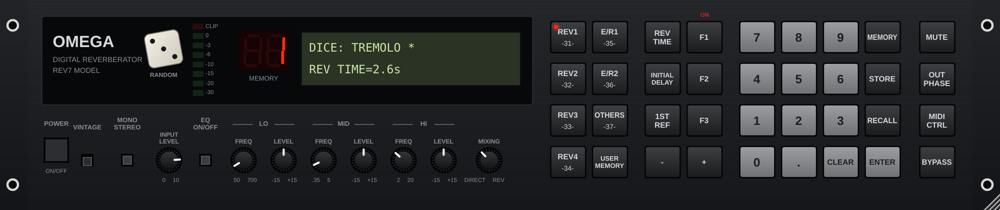

# Omega plugins

The Omega System's instruments and effects as separate VST3 plugins (AU too on Mac), for any desktop DAW.
The sound engines are line-for-line C++ ports of the web app's own code (`index.html`); `tools/compare.mjs` runs the
app's code in Node and the C++ in `tools/dsp_test.cpp` on the same signal, and their levels match.

| Plugin | Type |
|---|---|
| Omega Prophet-5 | instrument |
| Omega Vox (Prophet-5 + vocoder + talking machine) | instrument |
| Omega Speech (talking machine) | instrument |
| Omega Vocoder 350 | effect (MIDI or sidechain carrier) |
| Omega Lexicon 224, PrimeTime, Effectron, DP4, Microverb, ADA Flanger, 1176, Phil Collins Sim, H910, MXR 113 | effects |
| Omega Bus Compressor, Resonance Tamer, Gate Stepper | effects |
| Omega REV7 (Yamaha REV7 model with its own front panel) | effect |
| Omega Twelve (12-bit sampler emulator, also a standalone app) | effect with MIDI in: live input through the sampler, samples played from MIDI |
| Omega Twelve Instrument | instrument (same, for hosts that only send MIDI to instruments) |

Download: the `vst3-latest` release has a zip for Windows, Mac and Linux, built by `.github/workflows/vst3.yml`.

Build yourself: `cmake -S plugins -B build -DCMAKE_BUILD_TYPE=Release && cmake --build build --config Release`.
Parameter tables come from the app: `node plugins/tools/gen.mjs` regenerates `gen/tables.inc`.

Omega Twelve lives in `twelve/` and doesn't use the shared Spec/Editor: it has its own sample editor, presets (generated from the
app by `node twelve/tools/gen.mjs`), master chain and file export. Tests: `twelve_test` + `node twelve/tools/compare.mjs`
(C++ against the app's engine), `twelve_proc_test` (sampler, MIDI, exports, analysis, state), and `tools/hosttest` (`twelve_host_test`
loads the built .vst3 like a DAW).

## Omega REV7

A model of the Yamaha REV7 digital reverberator (1985), built from its service manual
([archive.org](https://archive.org/details/yamaha_yamaha_rev7)).
- **Analog path** (the manual's circuit description): input level (8 = unity, 10 = +12 dB), 3-band parametric EQ ahead of the
  converter, 12 kHz LC low-pass, pre-emphasis (+8 dB at 10 kHz), sample and hold, 16-bit A/D at 31.25 kHz (one channel),
  16-bit D/A (L/R), 12 kHz low-pass, de-emphasis and aperture compensation. The VINTAGE switch turns the converters and
  filters off.
- **DSP**: runs at the REV7's own 31.25 kHz. REV programs have 3 early reflections per channel, then a tank with mid,
  high (x0.1-1.0) and low (x0.1-2.4) reverb times and diffusion 0-10. E/R programs have 18 reflections per channel, with
  the six modes (small hall, large hall, random, reverse, plate, spring), liveness and room size. Then Delay, Echo (feedback
  plus high damp), Stereo Flange, Reverb Flange, Chorus A/B (DM + AM), Stereo Phasing, Tremolo and Symphonic. Every program
  has the centre 1st reflection. Measured decay is within about 8% of REV TIME.
- **Presets (144)**: the 30 factory programs, with the values from the manual's ROM contents chart (program 15 is SYMPHONIC,
  checked by `rev7_test`), 14 artist presets, and a library of 100 in `src/Rev7Library.inc`: 2 Live Crew (a Miami bass
  set for "Throw the D"), Symphonic (10 built on program 15), Drums, Vocals, Keys, Guitar & Bass, Electro & Hip-Hop,
  Spaces and Special FX. These presets are this plugin's own settings and were not matched against recordings. The LCD
  menu shows one submenu per category. The artist presets:
  The artist presets are this plugin's own settings, based on what these musicians and engineers have said about using a
  REV7 (gear lists and interviews collected on [Equipboard](https://equipboard.com/items/yamaha-rev-7)):
  Jean-Michel Jarre, Rick Wakeman, Tony Banks, The Prodigy, Graham Massey, Charlie Burchill, Martyn Ware,
  Daniel Miller, Paul Hardcastle and Minoru Mukaiya. They are not those artists' own stored programs. The same goes for the 2 Live Crew set, which follows the record's style.
- **Panel** (`src/Rev7Editor.cpp`): REV1-4 / E/R1-2 recall 1-6. Type a number and press RECALL for 1-30, or 31-90 for
  user memories. Type 31-90 and press STORE to save there; user memories are saved with your project. REV TIME,
  INITIAL DELAY, 1ST REF and F1-F3 pick a parameter, and what F1-F3 do depends on the program type, as on the unit.
  Change it with -/+, the mouse wheel on the LCD, or by typing a value and pressing ENTER. Click the LCD for the full
  preset menu. MUTE, OUT PHASE (inverts the wet signal) and BYPASS all work. The window resizes.
  The **dice** in the display window rolls a random preset from all 144. Shift-click or right-click it to roll new
  settings instead: a random program (1-30) whose parameters are rolled within useful ranges for its type. The keys
  are R and Shift+R. `rev7_shot` rolls it 200 times with audio running as a test.
- **Not from the unit**: the DSP coefficients and the reflection patterns. Yamaha's microcode and preset data live in
  the unit's 16 KB EPROM, and this model does not use or include that firmware. These values are this model's own,
  written to match the manual's descriptions. The REV TIME values for presets 16-18 are estimates, since the chart has
  no REV TIME for them. The name of preset 16 is not legible in the manual scan.
- **Tests**: `rev7_test` renders every preset at 44.1, 48 and 96 kHz and checks the levels and tails. `tools/hosttest`
  `rev7_host_test` loads the built .vst3 like a DAW. `rev7_shot out.png` draws the panel.
